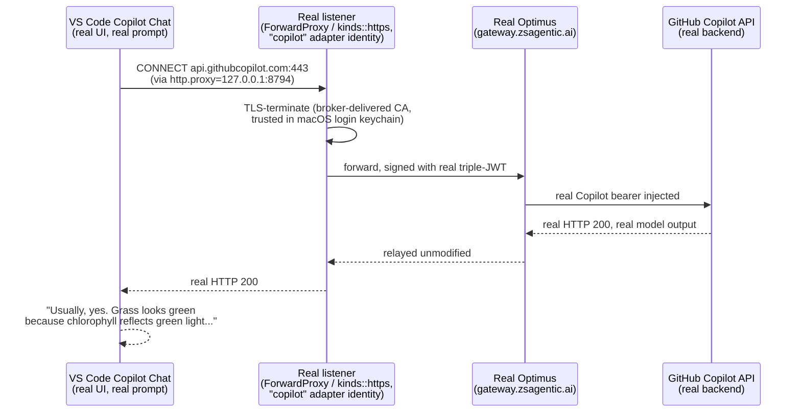

# VS Code Copilot, through real Optimus — real end-to-end verification

2026-10-19. Answers the question the kernel-redirect prototype work kept
deferring: independent of the WFP connect-redirect driver, does the
`http.proxy`-driven CONNECT mechanism actually carry a real VS Code Copilot
Chat request through real CA-trust TLS termination, real Optimus, to the
real GitHub Copilot backend, and back? Answer: **yes, confirmed live** — a
real prompt typed into the real VS Code Copilot Chat UI ("is the grass
green") got a real model answer, with the request having actually passed
through our listener and real Optimus (`gateway.zsagentic.ai`) on the way.

Companion to `vscode-copilot-redirect-windows-handoff.md` (the kernel-level
redirect mechanism this run deliberately did **not** use) and
`copilot-desktop-real-optimus-e2e.md` (the analogous proof for the GitHub
Copilot desktop app, done 2026-09-29). The mechanism this run exercises is
the one that needs no driver at all: VS Code's own `http.proxy` setting
pointed at a real `ai-gateway` listener.

## The final proof, as a sequence



## Components used

| Component | Role | Location |
|---|---|---|
| **`--sim-daemon` harness** | Dev-only harness that plays ai-protect's file-protocol slice: spawns the real `zscaler-ai-gateway` service binary, writes `.broker.zip`, polls `.status.zip` | `ai-protect/ai-gateway/service/src/control/sim_daemon.rs` |
| **`"copilot"` adapter identity** (GitHub Copilot CLI) | Its `LlmRouting::ForwardProxy{enabled:true}` config maps to `kinds::https` — the CONNECT-capable listener kind, unlike `vscode-copilot`'s own `CopilotDiscoveryRelay` routing, which binds a plain HTTP discovery-relay listener instead. Used as the test target specifically because it is the one that actually answers a CONNECT. | `ai-gateway/agent-manager/src/agents/mod.rs` (`LlmRouting` enum) |
| **`ca_trust.rs`** | Installs the broker-delivered CA into the macOS login keychain for the console user, so the listener's TLS termination is trusted | `ai-protect/ai-gateway/service/src/ca_trust.rs` |
| **`zax_sdk::enroll`** | Real pipeline: register (Vector `/v1/sdk/agents:register`) → approve (admin transition) → activate (Bumblebee) → token-exchange → real triple JWT | `ai-gateway/sdk/src/enroll/stages.rs` |
| **`get_copilot_token.sh`** | Real GitHub OAuth device-code flow → real Copilot bearer, written to `token.txt` next to the script | `ai-gateway/scripts/get_copilot_token.sh` |
| **VS Code `settings.json`** | `http.proxy` pointed at the real listener's port so VS Code's own HTTP client (and Copilot Chat's) tunnels through it | `~/Library/Application Support/Code/User/settings.json` |
| **Optimus** (`gateway.zsagentic.ai`) | The real policy gateway — confirmed reached at the TCP level (`lsof` showing established connections to its real IPs) | EKS dev cluster, `zax-gateway` namespace |

## Tenant / OIDC parameters used

`--sim-daemon` was launched with `ZAX_CLOUD=prod` and
`ZAX_TENANT="https://aibroker-engineer.zslogin.net/"`; no
`ZAX_OIDC_CLIENT_ID` / `ZAX_OIDC_AUDIENCE` / `ZAX_OIDC_SCOPE` /
`ZAX_OIDC_*_PATH` overrides were set, so those fields went into
`.broker.zip` as empty strings — per `sim_daemon.rs`'s own doc, "blank means
the SDK default" — and the SDK's hardcoded `OidcParams::default()`
(`ai-gateway/sdk/src/authorization/oidc.rs:49-63`) is what was actually
used:

| Parameter | Value used | Source |
|---|---|---|
| Cloud | `prod` (`Cloud::Prod` → `zsagentic.ai`) | `ZAX_CLOUD=prod` |
| Tenant / issuer | `https://aibroker-engineer.zslogin.net/` | `ZAX_TENANT` |
| OIDC `client_id` | `zax.client` | SDK default (not overridden) |
| OIDC `audience` | `oneid` | SDK default (not overridden) |
| OIDC `scope` | `openid offline_access` | SDK default (not overridden) |
| OIDC `authorize_path` | `/oauth2/v1/authorize` | SDK default (not overridden) |
| OIDC `token_path` | `/oauth2/v1/token` | SDK default (not overridden) |
| OIDC `discovery_path` | `/.well-known/openid-configuration` | SDK default (not overridden) |

These are fixed, non-per-tenant values (`OidcParams::default()` has no
tenant-awareness) — the same defaults every other agent identity on this
tenant authenticates with, not something specific to this run.

## What was actually run, in order

1. **Real backend registration/approval/activation**, via the `--sim-daemon`
   harness against the real `aibroker-engineer.zslogin.net` tenant.
2. **Real CA generation and macOS keychain trust**, via `ca_trust.rs`'s
   normal per-snapshot install path — no manual cert handling.
3. **Real TLS-terminating listener** stood up for the `"copilot"` adapter
   identity (`ForwardProxy`/`kinds::https`), bound to a local port.
4. **VS Code `http.proxy`** pointed at that listener's port, so Copilot
   Chat's own traffic — not a synthetic `curl` — tunnels through it.
5. **Real prompt from the actual VS Code Copilot Chat UI**: "is the grass
   green" → real, correct answer, routed through the real pipeline above.
6. **Verified it was not a local echo**: confirmed via `lsof` that the
   listener process held established TCP connections to Optimus's real
   resolved IPs (`137.31.194.244`, `137.31.194.121`, `137.31.194.123`), and
   confirmed the response carried real GitHub response headers.
7. **Checked whether Optimus's policy engine (AI Guard) actually inspected
   this traffic.** Read Optimus's own source
   (`gateway-proxy/src/gateway.rs`, `gateway-extapi/src/ai_guard.rs`):
   `gateway::dump` is an opt-in debug log (`debug_dump_enabled`, default
   `false` — a sound production default, not a routing gap).
   `gateway::guard` is the real policy-decision log target. Pulled Optimus's
   current log (`dump.jsonl`, via `kubectl exec` into the
   `zax-gateway` namespace pods) and found **zero** `gateway::guard` entries
   for any tenant, not just this one. Conclusion: AI Guard / policy
   enforcement is simply not active on this dev cluster right now — an
   environment property, independent of anything built or tested today.

## Real issues found and fixed along the way

- **`package.version is required` (HTTP 400) on registration.** Root cause:
  `agent-manager::host_facts::software_for()`'s fallback logic only uses a
  declared software identity when **both** `software.name` and
  `software.version` are non-empty — setting version alone had no effect.
  Fixed in `sim_daemon.rs` by supplying both.
- **TLS provider panic in `copilot_discovery.rs`.** Its discovery client
  used `.with_webpki_roots()`, which needs a process-global `rustls`
  `CryptoProvider` this crate deliberately never installs. First hit when a
  real `vscode-copilot` activation actually drove this listener kind.
  Fixed with the crate's own explicit provider,
  `.with_provider_and_webpki_roots(crate::tls::default_provider())`.
- **`vscode-copilot` had no dedicated backend `agent_type`.**
  `registry_agent_type()` fell through to the generic `"custom"` value.
  Confirmed (by reading `vector`'s `internal/agentonboard/service.go` and its
  seeded `ootb/github-copilot.yaml`) that the backend has a dedicated
  `"copilot"` value meant for exactly this. Added the explicit mapping.
- **VS Code's own `http.proxy` pointed at a long-dead port** (`1234`, a toy
  proxy killed many steps earlier) when the first real Copilot Chat prompt
  failed ("Sorry, your request failed... Error on conversation request").
  Found by reading `settings.json` directly rather than guessing; fixed to
  point at the real, live listener port (`8794`) — this fix is what made the
  final successful run possible.
- **ZCC's own TLS interception masked the real response, twice** — once on a
  direct `curl` test, once on the real VS Code Copilot Chat test. Both times
  ZCC had to be turned off to reach the real backend/Optimus without its
  "Domain Fronting" block page standing in the way. See
  [[feedback_remind_shutoff_zcc_optimus_tests]] (tension: reading Optimus's
  own logs needs ZCC **on**, to reach the EKS cluster — the opposite
  requirement, which meant toggling it on/off between the test and the log
  check).

## What this actually proves

- The `http.proxy`-driven CONNECT mechanism — capture, CA-trust TLS
  termination, and the real Optimus relay — works end to end on macOS, with
  no kernel/driver component at all.
- A real, interactively-typed VS Code Copilot Chat prompt genuinely
  round-trips through this pipeline to the real GitHub Copilot backend and
  back, not just a synthetic `curl` probe.
- Real Optimus, today, forwards this brokered traffic without AI Guard
  policy inspection — confirmed as a dev-cluster environment state, not a
  defect in the agent's traffic handling.
- `vscode-copilot`'s own `CopilotDiscoveryRelay` routing (`kinds::copilot_discovery`,
  a plain-HTTP discovery-relay listener, not CONNECT-capable) was **not**
  the mechanism under test here — the `"copilot"` GitHub Copilot CLI
  adapter's `ForwardProxy`/`kinds::https` listener was, since it's the one
  that actually answers a CONNECT the way VS Code's `http.proxy` setting
  issues one. Whether `vscode-copilot`'s own routing should also move to
  `ForwardProxy` for this use case is an open follow-up, not yet decided.

## Branch record — carrying the real fixes forward cleanly

Two of the fixes above (`enrol.rs`'s agent_type mapping,
`copilot_discovery.rs`'s TLS provider fix) are real product fixes, not
net_egress or kernel-redirect code. To keep them out of the
driver/connect-redirect work entirely, they were committed onto a fresh
branch built straight off `origin/main-08272026`, carrying only the
`vscode-copilot`/`http.proxy` wiring (CAPI-discovery relay) plus these two
fixes — explicitly zero driver or net_egress files:

**`main-08272026-vscode-copilot-electron-stack-simple`** (pushed to origin):

```
6e516e13 vscode-copilot: map to backend agent_type "copilot", fix discovery listener's TLS provider panic
ca099e3d vscode-copilot: add fields required by the post-merge AgentSpec/BinaryHints
a2a7f8cb Wire vscode-copilot into the real ai-protect/ai-gateway: CAPI-discovery relay
45a7c39d Add vscode-enterprise-simple and real-token helper scripts
4b4240fe Add ai-gateway-simple / ai-protect-simple: unprivileged VS Code protocol test pair
```

`cargo check --workspace` passes clean on this branch (exit code 0, only
pre-existing `dead_code` warnings, unrelated to these changes). A Windows
full build (`cargo build --workspace`) off this same branch was kicked off
immediately after, on a separate Windows laptop, to confirm it also builds
cross-platform.

Separately, the `main-08272026-vscode-copilot-electron-stack` branch (the
kernel-redirect/driver work) was reconciled to carry forward only the
docs-only `zsai-netflt` commits (`b6e186d5`, `4641ea06`, `4c96b08b`,
`e85521fc`, `7c77b4e2`, `dd50b66f`), explicitly excluding the actual kernel
C code (`6caa0a34`) and its VM test harness (`546b1664`), and verified to
touch zero net_egress files.

## Real, persistent side effects of this investigation

- A real registration/activation now exists for the test agent identity on
  the `aibroker-engineer.zslogin.net` tenant (via `--sim-daemon`), with real
  credentials persisted under `~/.zsai-gateway/`.
- A real Copilot bearer token (from `get_copilot_token.sh`) is on disk at
  `ai-gateway/scripts/token.txt`, carrying a `proxy-ep=proxy.business.githubcopilot.com`
  claim — this account's real CAPI host, not the generic
  `api.githubcopilot.com`.
- The broker-delivered CA remains installed in the macOS login keychain
  (no automatic removal on shutdown — only superseded by a newer CA on the
  next snapshot).
- `~/Library/Application Support/Code/User/settings.json`'s `http.proxy` is
  left pointed at the real listener port (`8794`), not reverted to unset —
  intentional, so the setup is immediately reusable for a follow-up run.
