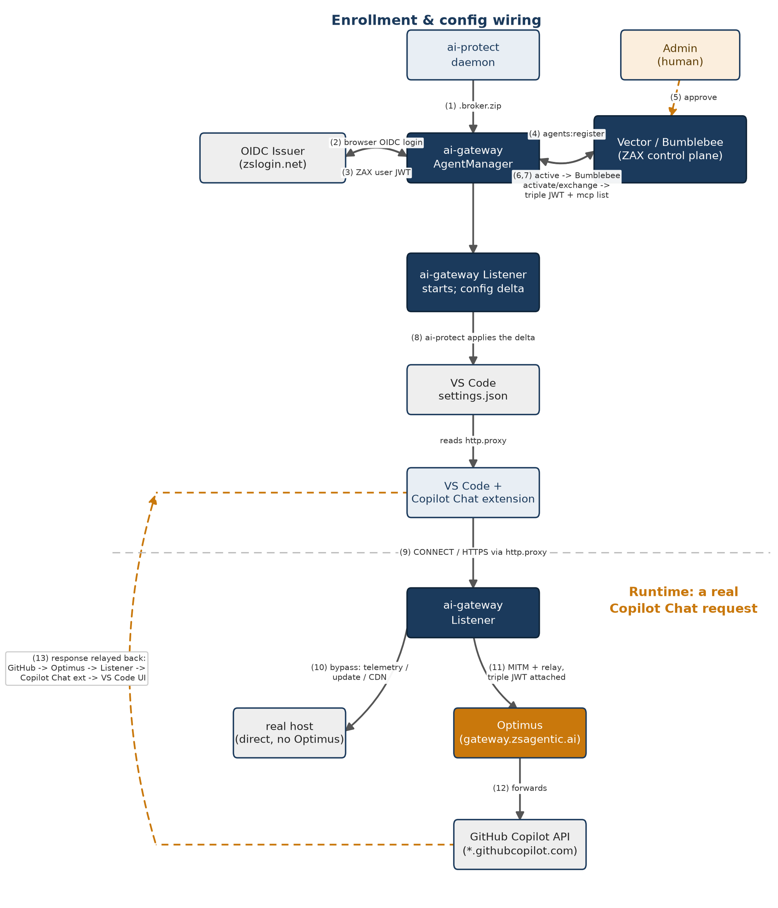

# VS Code Copilot's four account modes, and why the shipped solution doesn't care which one a customer is on

2026-10-23. **Two mechanisms were tried for routing VS Code Copilot Chat
traffic through Zscaler, and we settled on the second one.** The first — the
older `github-enterprise.uri` CAPI-discovery hijack
(`LlmRouting::CopilotDiscoveryRelay`) — turned out to be gated on GitHub
account tier (`enterprise: true`) in a way that closes it for most
customers. The second — VS Code's `http.proxy` setting, with full MITM via a
locally-trusted CA (`LlmRouting::ForwardProxy`) — is not account-tier-gated
at all, was shipped and live-proved this session, and is what the rest of
this doc, and the shipped code, are built around. The full reasoning behind
that choice, and the prior investigation it builds on, is in
[Appendix A: the two approaches considered](#appendix-a-the-two-approaches-considered-and-why-we-settled-on-the-second)
at the end of this doc.

## Architecture: components and message flow



*Regeneratable from `ai-testing/scripts/make_vscode_copilot_diagram.py` -- edit the `BOXES`/`ARROWS` data there and re-run it (see that script's header) rather than hand-editing the PNG.*

### Arrow-by-arrow detail

1. **ai-protect daemon -> `.broker.zip`**: discovery (`scan_inventory` +
   `collect_builtin_extensions`, Issue 4) recognizes VS Code and the
   built-in Copilot Chat extension; `discovered_broker_agents()` (Issue 5)
   now yields **both** `copilot` and `vscode-copilot` as candidates from
   that one signal. Writes the resolved tenant config (`cloud`/`oidc` from
   `init.yaml` or pushed settings, Issues 2/3) plus the discovered-agent
   list to `.broker.zip`.
2. **ai-gateway -> OIDC Issuer**: on seeing a usable tenant OIDC config,
   `AgentManager` opens a system browser to the issuer's authorize endpoint
   (PKCE). This is the **gateway's own** separate OIDC login — distinct
   from ai-protect's device-plane enrollment (two separate backends; see
   the DVM runbook above).
3. **OIDC Issuer -> ai-gateway**: the issuer redirects back with an
   authorization code; the SDK exchanges it for tokens. The resulting ZAX
   user JWT feeds every backend call from here on.
4. **ai-gateway -> Vector**: `agents:register`, once per discovered agent
   id (here, both `copilot` and `vscode-copilot`) — since the two share the
   same backend `agent_type`, this can resolve to one underlying
   registration (confirmed live: one approval covered both).
5. **Admin -> Vector**: a brand-new device/agent pair lands in
   `pending_approval` until an admin acts. This session used
   `zax-sdk-python/script/approve_agent.py` — a real, interactive
   browser-based admin login — against Vector's `/vector/v1/admin/
   agent-operations/{id}/transition`.
6. **Vector -> ai-gateway**: the registration flips to `status: active`;
   `AgentManager`'s periodic `agents:status` poll (observed every ~10s)
   picks it up.
7. **ai-gateway -> Bumblebee -> Vector**: `/activations` (user JWT + agent
   identity -> instance JWT), then `/token-exchange` (instance JWT -> the
   triple JWT, carrying `intersected_caps`), then back to Vector's
   `/sdk/mcp-servers` for the MCP broker list.
8. **ai-gateway -> ai-protect -> VS Code**: the Listener starts and a
   config delta is computed; ai-protect's `.status.zip` watcher applies it
   — for the `vscode-copilot` identity specifically, this writes `http.proxy`
   directly into VS Code's own `settings.json` (Issue 5's live
   confirmation).
9. **VS Code -> ai-gateway Listener**: the Copilot Chat extension's
   Electron fetcher reads `http.proxy` and routes *every* outbound HTTPS
   connection through it — model calls, telemetry, update checks, and
   marketplace/CDN fetches alike, with no distinction at this layer.
10. **Listener -> real host, direct**: for a destination matching
    `BYPASS_HOSTS` (Issue 6) — telemetry/update/CDN noise — the Listener
    dials the real destination directly at the plaintext CONNECT stage,
    before any MITM, and splices raw bytes. This traffic never reaches
    Optimus (see the account-mode gap analysis above for which domains this
    does and doesn't cover yet).
11. **Listener -> Optimus**: for everything else, the Listener terminates
    TLS using its locally-trusted CA, reads the plaintext request, and
    relays it to Optimus (`gateway.zsagentic.ai`) over a fresh connection,
    attaching the triple JWT from step 7 as the request's credential.
12. **Optimus -> GitHub Copilot API**: Optimus forwards the request to the
    real upstream named in it (e.g. `api.business.githubcopilot.com`) —
    this is also the one hop where Zscaler's own policy enforcement (DLP,
    visibility, model-use rules) actually acts, since it's the only point
    that sees real, decrypted traffic.
13. **GitHub Copilot API -> ... -> VS Code**: the response is relayed back
    along the exact same path in reverse, re-encrypted toward the client at
    the Listener, through the Copilot Chat extension, and rendered in VS
    Code's Chat panel. This exact sequence, for a real prompt, is what
    produced the clean response confirmed earlier in this doc.

## The four modes, restated precisely

Per GitHub's own docs (see Sources) and the two existing docs above, "four
modes" is really two independent axes, plus one mode (GHE.com) that moves
along both:

| # | Mode | Axis 1 — hosting | Axis 2 — Copilot billing | `enterprise:` flag |
|---|---|---|---|---|
| 1 | **Consumer** | ordinary multi-tenant `github.com` | Individual | `false` (confirmed live) |
| 2 | **Business** | ordinary multi-tenant `github.com` | Business seat | `false` (confirmed live, real seat) |
| 3 | **Enterprise** | ordinary multi-tenant `github.com`, Enterprise-account membership | Business or Enterprise seat | `false` (confirmed live, real membership) |
| 4 | **GHE.com** | dedicated `<slug>.ghe.com` instance (Enterprise Cloud w/ data residency) | Business or Enterprise only — no Individual | Untested; "likely yes" per the matrix, never confirmed against a real tenant |

Modes 1–3 all live on ordinary `github.com` and talk to the same model/API
domain family (`*.individual|business|enterprise.githubcopilot.com` — the
plan name is baked into the hostname, confirmed against GitHub's own
allowlist reference). **GHE.com is the only mode with a genuinely different
network footprint**: almost everything — auth, API, telemetry — moves to
`https://*.<slug>.ghe.com`, replacing the `github.com`-hosted endpoints
entirely (`default.exp-tas.com` client-experimentation telemetry is dropped
outright; Individual-plan routing isn't supported since GHE.com has no
Individual tier).

## Why the shipped mechanism doesn't need to know which mode it's on

`ForwardProxy` (`agents/vscode_copilot.rs`, `http.proxy` → our listener →
full TLS MITM via a CA trusted machine-wide, confirmed live this session on
the DVM through real Optimus, real OIDC, a real Vector-registered agent
identity, and a real Copilot Chat response) operates at a layer below all
four modes:

- **VS Code's `http.proxy` is Electron/Chromium-level**: it routes *every*
  outbound HTTPS connection the process makes through the configured proxy,
  unconditionally — it has no concept of which GitHub account, billing tier,
  or hosting domain is involved. This is exactly the lever
  `vscode-copilot-enterprise-gate-account-test.md` §5 first found working
  (pass-through only, consumer/Business-seat account) — this session matured
  it into full MITM + real backend wiring.
- **Our listener's CONNECT handling doesn't filter by destination either**:
  it mints a leaf certificate for whatever authority a client's CONNECT
  names and relays based on that, dynamically, per connection — never a
  fixed domain list. A CONNECT to `api.business.githubcopilot.com:443` and
  one to `copilot-proxy.<slug>.ghe.com:443` are handled by the identical code
  path.
- **The old lever's gate (`enterprise: true`) never enters this path at
  all** — it was specific to `defaultAccount.ts`'s discovery-URL derivation,
  a mechanism this product no longer uses for vscode-copilot.

**Conclusion: for modes 1–3 (consumer, business, enterprise-member), the
shipped mechanism is confirmed working and is not account-tier-gated in any
way** — it directly supersedes the old matrix's "needs an unbuilt
network-egress hook" verdict for 6 of its 8 rows (rows 1–3 and 5–7). No
network-egress kernel hook (macOS `NETransparentProxyProvider`, Windows WFP
redirect callout) is needed for these modes; `http.proxy` + MITM already
does the job, proven live.

## GHE.com (mode 4/8): reasoned, not yet live-verified

Nothing in the core interception mechanism depends on a fixed domain, so
**the core MITM/relay itself should work identically for GHE.com** — a
CONNECT to any `*.<slug>.ghe.com` host is handled the same as any other
authority. But two things are genuinely untested, not just theoretically
fine, and shouldn't be asserted as working until a real GHE.com tenant is
available:

1. **Whether GHE.com's sign-in/SSO flow tolerates being MITM'd at all.**
   Login/SSO flows sometimes carry extra TLS assumptions (certificate
   pinning, stricter transport checks) that ordinary API calls don't —
   untested on *any* mode's sign-in in this session, since the DVM run used
   an already-enrolled identity end to end, not a fresh interactive
   Copilot sign-in through our proxy.
2. **Whether the `enterprise: true` flag matters for `ForwardProxy` at
   all.** It shouldn't (per the mechanism description above) — but the old
   docs' matrix flagged real uncertainty about whether a genuine
   dedicated-instance sign-in even sets that flag, and `ForwardProxy`
   doesn't read it either way, so this is moot for us specifically. Noted
   only so a reader of the old matrix doesn't conflate the two mechanisms.

No Zscaler-controlled GHE.com tenant exists to test against directly
(`vscode-copilot-enterprise-gate-account-test.md` §3, confirmed by Zscaler's
own GitHub admin) — closing this needs either a customer's real GHE.com
tenant or a trial one.

## The one real, concrete gap this session's work introduced: `BYPASS_HOSTS`

The core `ForwardProxy` mechanism generalizes cleanly (above). The **new
non-MCP/non-LLM bypass feature** (`ai-gateway/listener/src/kinds/https.rs`,
`BYPASS_HOSTS`, landed this session — see `ISSUES.md` Issue 6 in this same
folder) does **not**, and this is worth being precise about rather than
asserting it generalizes when it doesn't:

- `BYPASS_HOSTS` is a hardcoded list keyed off hostnames observed on **one**
  consumer/Individual-tier account on **one** DVM session:
  `telemetry.individual.githubcopilot.com`, `update.code.visualstudio.com`,
  `main.vscode-cdn.net`, `mobile.events.data.microsoft.com`,
  `*.applicationinsights.azure.com`.
- GitHub's own allowlist reference names the model/API domains per-tier
  (`*.individual|business|enterprise.githubcopilot.com`) — telemetry may
  well follow the same pattern (`telemetry.business.githubcopilot.com` for
  a Business account, untested), which `BYPASS_HOSTS` does not cover today.
- **GHE.com replaces essentially all of this list's domains** with
  `*.<slug>.ghe.com` equivalents (and drops `default.exp-tas.com`
  entirely) — none of today's `BYPASS_HOSTS` entries would ever match a
  GHE.com tenant's traffic.
- **This fails safe, not open.** A host that doesn't match `BYPASS_HOSTS`
  simply takes the default path: full MITM, relayed through Optimus, same
  as the actual Copilot Chat traffic. Business/Enterprise/GHE.com telemetry
  we haven't enumerated yet doesn't leak around interception or break
  anything — it's just not optimized off Optimus the way consumer-tier
  telemetry now is. Verified-safe, not verified-complete.
- **Follow-up, not urgent**: once a Business/Enterprise or GHE.com account
  is available to test against, capture its actual telemetry/update/CDN
  hostnames the same way this session captured the consumer-tier ones
  (`debug-service.log`'s `logical/eventual_target=` lines), and extend
  `BYPASS_HOSTS` — the same two-options tradeoff documented at that
  constant's definition still applies to whatever gets added.

## Summary

| Mode | Core interception (`ForwardProxy`) | Optimus-bypass feature (`BYPASS_HOSTS`) |
|---|---|---|
| Consumer | **Confirmed working, live, this session** | **Confirmed working** for the domains this session observed |
| Business | Should work identically (domain-agnostic mechanism) — not independently tested | Likely under-covers Business-tier telemetry hostnames (untested) — fails safe to full MITM |
| Enterprise (member) | Should work identically — not independently tested | Same gap as Business |
| GHE.com | Should work for the core MITM/relay (domain-agnostic) — sign-in-flow TLS behavior genuinely untested, no tenant available | Does not cover `*.ghe.com` at all today — fails safe to full MITM |

## Everything built this session, file by file

The account-mode analysis above is about one question (does the shipped
mechanism generalize). This section is the complete engineering record
behind "the shipped mechanism" — every code file touched, what changed in
it, and why — so this doc stands on its own without needing `ISSUES.md`
open side by side. `ISSUES.md` (this same folder) has the full narrative,
live-log evidence, and exact line numbers for each; this is the condensed,
file-oriented index.

### Wiring vscode-copilot onto its own identity (pre-dates the numbered issues)

- **`ai-gateway/agent-manager/src/agents/vscode_copilot.rs`** — `SPEC.llm`
  changed from `LlmRouting::CopilotDiscoveryRelay` (the `github-enterprise.uri`
  hijack this doc's first half is about — confirmed a dead end for any
  ordinary sign-in) to `LlmRouting::ForwardProxy { proxy_key: "http.proxy",
  ca_env: &[], enabled: true }`. **Design**: the discovery-relay run through
  Optimus that originally proved real `/chat/completions` traffic could be
  routed used the `copilot` CLI adapter's identity as a stand-in, purely
  because it was already CONNECT-capable — not because vscode-copilot should
  depend on it. A real customer has no reason to have the GitHub Copilot CLI
  installed, so vscode-copilot needed its own `ForwardProxy` identity instead
  of permanently borrowing `copilot`'s.
- **`ai-gateway/util/src/agent_configs.rs`** — vscode-copilot's `shape`
  changed from `Shape::Llm(Llm::ProxyPath { path: &["github-enterprise.uri"],
  .. })` to `Shape::Llm(Llm::Scalars { proxy_key: Some("http.proxy"), .. })` —
  the config-render side of the same move: write a flat `http.proxy` key into
  VS Code's own `settings.json` instead of the discovery-hijack path.

### Listener observability (also pre-dates the numbered issues)

- **`ai-gateway/listener/src/kinds/mod.rs`** — `forward()`'s log line
  rewritten to separate `logical/eventual_target` (what the request's Host/
  CONNECT authority claims, labeled with its source) from `dial_target`/
  `resolved_dial_addr` (where the socket actually connected). **Design**:
  before this, one ambiguous field conflated "what this request is logically
  for" with "where the TCP socket went," which had already caused one real
  misreading earlier in this investigation (concluding Optimus was bypassed
  when it wasn't). This exact log format is what made Issue 5's and Issue
  6's live verification possible — without named `dial_target`, there'd be
  no way to tell a bypassed connection from a relayed one by log inspection
  alone.
- **`ai-gateway/listener/src/gateway.rs`** — added `Destination::
  resolve_with_source()` (names which of 4 sources supplied a destination:
  CONNECT authority, configured override, request-line authority, or the
  `Host` header) and `Gateway::last_dial_addr()`/`authority()` accessors
  backing the log line above.

### Issue 3 — `client_id` never merged into the tenant's OIDC config

- **`src/subscribers/ai_broker_launch.rs`** — `InitOidc` gained a `client_id`
  field; `tenant_from_with`/`tenant_from_init` now merge it with the same
  settings-wins/`init.yaml`-fills-the-gap rule already used for `issuer`.
  New test: `client_id_follows_the_same_override_rule`. **Design**: the
  merge function structurally could not populate `client_id` from either
  layer before this — `Oidc { issuer: ..., ..Oidc::default() }` always left
  every other `Oidc` field blank regardless of what was supplied, and the
  one correct fallback (`"zax.client"`) lived one layer too late (in the
  request-builder, after the usability gate had already failed and logged).
  The fix adds the missing merge rather than moving the fallback earlier,
  so the gate observes the same value the eventual request would use.

### Issue 4 — VS Code's built-in Copilot Chat extension was invisible to discovery

- **`src/tasks/ide/vscode.rs`** — new `collect_builtin_extensions()`, wired
  into `find_extensions()`'s existing cache-population loop alongside
  `collect_extensions()`. Three new tests:
  `a_builtin_extension_is_found_without_an_extensions_json_entry`,
  `a_builtin_extension_under_a_hash_named_update_subdir_is_found` (the real
  layout), `a_malformed_builtin_entry_is_skipped`. **Design**: the existing
  `collect_extensions()` only ever read `<editor>/extensions/extensions.json`
  — the marketplace-install catalog — because that was the only install
  shape this module knew about. VS Code 1.142 ships `github.copilot-chat` as
  a *built-in*, bundled inside the app's own install directory, which is
  never registered in that catalog at all; built-ins and marketplace
  extensions are two separate tracking mechanisms in VS Code itself. The fix
  adds a second, parallel collection pass reading `package.json` directly out
  of the install directory, producing the identical `Extension` shape so
  every existing/future `find_extensions()` caller benefits with no
  per-agent special case — deliberately not generalized beyond stock VS Code
  on Windows yet (see the account-mode table above for the parallel
  per-account-tier gap this leaves).
  - First attempt also assumed `resources/app/extensions` sits directly
    under the install root; live-checked wrong — Windows' background updater
    stages the real build under an opaque hash-named subdirectory instead,
    sometimes two of them coexisting after an in-place update. Fixed by
    checking both layouts.

### Issue 5 — `vscode-copilot` never got a chance to enroll under its own identity

- **`src/subscribers/ai_broker_launch.rs`** — `discovered_broker_agents()`
  now pushes `"vscode-copilot"` as a *second* candidate whenever a folder's
  label is `"vscode"`, alongside whatever `client_label_to_broker_id` already
  returns (`"copilot"`, unchanged). Added `sources_for("vscode-copilot")`
  (identical hints to `"copilot"` — same signal, different identity) and
  registered it in the `ALL_BROKER_IDS` test fixture so the existing
  completeness tests cover it automatically. **Design**: `client_label_to_
  broker_id` deliberately folds VS Code's presence into the `copilot` CLI id
  (a real, intentional design for that function's own purpose). The gap was
  that this was the *only* path — nothing ever gave `vscode-copilot` a
  chance to enroll under its own identity, so even with Issues 3/4 both
  fixed, a real end-to-end enrollment landed its config deltas in `~/.copilot/
  settings.json` (the CLI's file), never VS Code's own `settings.json`. The
  fix doesn't change the existing `copilot` mapping at all — it adds
  `vscode-copilot` as an additional, independent candidate from the same
  signal, so both identities get to enroll from the same VS Code install.

### Issue 6 — Optimus bypass for non-MCP, non-LLM traffic

- **`ai-gateway/listener/src/kinds/https.rs`** — `BYPASS_HOSTS` const +
  `should_bypass_optimus()`, checked at the plaintext CONNECT stage (before
  any MITM) in `sniff_inner`. Three new tests covering exact match, subdomain
  match, and the dot-boundary guard against a false-positive substring match.
- **`ai-gateway/listener/src/server.rs`** — `Prepared` gained a `bypass_to`
  field and a `Prepared::bypassed()` constructor; `serve_with_prepare` checks
  it before TLS accept or HTTP serving even start; `splice_bypassed()`/
  `dial_direct()` do the actual direct dial + raw `copy_bidirectional` relay.
  Three new tests (loopback dial success/failure, and an end-to-end splice
  proving bytes relay unmodified in both directions).
- **Design — two options were considered, both documented in full at
  `BYPASS_HOSTS`'s own definition in the code**:
  1. Client-side: write `http.proxy`'s sibling, `http.noProxy`, into VS
     Code's `settings.json` naming these hosts.
  2. Server-side (chosen): bypass at the plaintext CONNECT stage, before any
     MITM, splicing raw bytes directly to the real destination.
  Chosen (2) because it's one list to maintain at the point traffic is
  actually observed (rather than one layer removed, in `agent_configs.rs`),
  and because it sidesteps re-encrypting traffic the gateway was never going
  to act on — this exact session's own capture showed a dropped tunnel + a
  client-reported `websocket.error` in this same traffic class (see Issue
  5's live-confirmation bullet). Accepted tradeoff: bypassed traffic gets
  zero visibility/audit on our side — deliberate for telemetry/update/CDN
  noise, and exactly why an LLM or MCP destination must never be added to
  the list. See the gap analysis above for why this list doesn't yet
  generalize across account modes the way the core mechanism does.

### Issue 1 — startup crash (still open, not part of this doc's scope)

`STATUS_STACK_BUFFER_OVERRUN` in `zscaler-ai-protect.exe`, ~50s after a
fresh MSI install's first service start. Ruled out as an installer problem;
not yet root-caused or confirmed reproducible. No code changed for this one
this session — see `ISSUES.md` Issue 1 for the full WER/event-log detail and
the next steps (pull the WER dump, try to reproduce via a manual service
restart).

## Setting up a disposable VM to test this, step by step

Everything in this session ran against a real Windows disposable VM (DVM) —
no simulator, no fixture harness. This is the full runbook, gotchas
included, so someone else can reproduce it without re-discovering each one
live.

### 1. Connect to the DVM

- Confirm RDP is reachable: `Test-NetConnection -ComputerName <ip> -Port 3389`.
- Build a `.rdp` file (or use `mstsc` directly) with, notably:
  `authentication level:i:0` — a self-signed/internal host fails cert
  validation at the default level (`i:2`), which surfaces as a generic
  "certification authority could not be contacted" error.
- Store credentials via Windows Credential Manager (`cmdkey`), never in
  plaintext in the `.rdp` file — or set `prompt for credentials:i:1` to type
  the password each time instead, if you'd rather not persist it at all.

### 2. Share this repo into the session

- On the host (your dev machine): `subst Z: "<path to this ai-protect checkout>"`.
  **Not persistent** — resets on logoff/reboot; redo it if file sharing
  stops working.
- Add `drivestoredirect:s:Z:` to the `.rdp` file (or enable the matching
  drive in `mstsc`'s Local Resources tab). Inside the DVM this appears as
  `\\tsclient\Z\...`.
- PowerShell handles `\\tsclient\Z\...` paths natively — no need to map a
  drive letter inside the DVM session itself.

### 3. Allow local scripts to run on the DVM

Default PowerShell execution policy blocks unsigned local scripts. As
Administrator/an elevated account on the DVM, once:

```powershell
Set-ExecutionPolicy -ExecutionPolicy RemoteSigned -Scope LocalMachine -Force
```

(`RemoteSigned` only blocks scripts *marked downloaded from the internet* —
anything copied over the shared drive runs fine. `Bypass` works too if you'd
rather not think about the distinction.)

### 4. Build and get the MSI onto the DVM

From the dev machine:

```bash
gh workflow run adhoc-build.yml --ref <branch> -f os=windows -f version=<X.Y.Z> -f environment=staging
gh run list --workflow=adhoc-build.yml --limit 3      # get the run id once it starts
gh run download <run-id> -n zscaler-ai-protect-msi-x64 -D .
```

- **`environment` must match whatever backend your test tenant actually
  exists on** — see step 6. `staging` and `dev` both dispatch immediately;
  **`prod` requires a GitHub Environment-protection admin approval and will
  sit `in_progress` indefinitely** without one — avoid it for fast iteration
  unless you specifically need a prod-baked binary and have an approver.
- Copy the downloaded `.msi` onto the DVM via the shared drive from step 2.

### 5. Install — the two gotchas that cost the most time this session

```powershell
msiexec /i "C:\full\absolute\path\to\the.msi" /L*V "C:\full\absolute\path\to\install.log"
```

- **Must run elevated.** The service install needs `LocalSystem`
  privileges; a non-elevated run doesn't partially install — MSI's
  transactional rollback undoes *everything*, leaving zero trace (no ARP
  entry, no files, no service). Confirm elevation first:
  `([Security.Principal.WindowsPrincipal][Security.Principal.WindowsIdentity]::GetCurrent()).IsInRole([Security.Principal.WindowsBuiltInRole]::Administrator)`
- **Must use the full absolute path, never a relative one** (`.\the.msi`).
  A relative path produces `Error 1324: The folder path '.' contains an
  invalid character` and a near-instant, silent failure
  (`MainEngineThread is returning 2`) — no UI, no obvious error, just
  nothing installed.
- Always pass `/L*V <logfile>` — cheap, and the only way to diagnose a
  failure after the fact. The log is UTF-16; decode with
  `iconv -f UTF-16LE -t UTF-8` or just `Get-Content` in PowerShell (which
  handles the encoding automatically).

### 6. Verify the install landed

Copy `scripts/verify-msi-install.ps1` (from this repo's own root, over the
shared drive) onto the DVM and run it:

```powershell
.\verify-msi-install.ps1 *>&1 | Out-File -FilePath 'C:\some\local\path\verify.txt'
```

Use `*>&1`, not a plain `|` — the script's PASS/FAIL lines are `Write-Host`,
which bypasses the normal output pipe entirely; a plain `| Out-File` would
silently capture almost nothing.

### 7. Enroll the device

Launch the installed app's enrollment UI and sign in — either SSO (org/
tenant slug) or an enrollment token. **The org/tenant must actually exist on
the backend your binary's `environment` was baked against** (step 4) — a
real, correct-looking slug still fails with *"We couldn't sign in to
'X'. Check your organization name..."* if it exists on a different
environment's backend than the one this binary points at. If SSO fails,
don't assume the slug is wrong before confirming which environment the
tenant actually lives on.

### 8. Get the ai-gateway broker itself authenticated

Device enrollment (step 7) and the gateway's own authentication are
**two separate backends** — enrolling the device does not by itself give
the gateway (the process that actually talks to Vector/Bumblebee/Optimus)
anything to authenticate with. If the real backend doesn't push
`settings.ai_gateway.{cloud,issuer,client_id}` for your tenant (checkable:
`debug-service.log` repeating `"the snapshot carried no usable OIDC
config"`), supply it locally instead:

As the **non-admin user the gateway runs as** (not the admin account):

```powershell
@"
cloud: prod
oidc:
  issuer: https://<your-oidc-issuer>/
  client_id: zax.client
"@ | Set-Content -Path "$env:USERPROFILE\.zsai-gateway\init.yaml" -Encoding ascii -NoNewline
```

- **`-Encoding ascii`, not `utf8`.** Windows PowerShell 5.1's `utf8`
  encoding writes a BOM, which breaks the YAML parser (`"deserializing from
  YAML containing more than one document is not supported"` — a confusing
  error for what's really just a stray BOM). `ascii` is safe since this
  content has no non-ASCII characters.
- Then, as Administrator, `Restart-Service zscaler-ai-protect` to make the
  daemon recompute and push a fresh snapshot to the gateway.
- **After *any* reinstall or restart, verify the gateway process is
  actually running fresh code** — an MSI upgrade cannot restart the
  gateway/UI processes itself (Windows Restart Manager logs `Event 10010`:
  *"Application SID does not match Conductor SID"*, since `msiexec` runs
  elevated while the gateway runs as the ordinary user). Check:
  ```powershell
  Get-Process zscaler-ai-gateway -ErrorAction SilentlyContinue | Select-Object Id, StartTime
  ```
  If it's missing, or its `StartTime` predates the new binary's
  `LastWriteTime`, force a respawn:
  `Stop-Process -Name zscaler-ai-gateway -Force`, then
  `Restart-Service zscaler-ai-protect` again and re-check.

### 9. Approve the agent registration, if one lands in `pending_approval`

From the dev machine, `zax-sdk-python` repo, using its pre-built
`.venv-approve` virtual environment:

```bash
.venv-approve/Scripts/python.exe script/approve_agent.py --agent-id <uuid-from-the-gateway-log>
```

- `script/admin.yaml` must point at the **same** `cloud`/`oidc.issuer` as
  the gateway's own `init.yaml` from step 8 — it's a separate admin login
  against the same backend.
- This opens a **real interactive browser login** a human has to complete
  — it can't be driven headlessly.
- `vscode-copilot` and the standalone `copilot` CLI identity register under
  the same backend `agent_type`, so one approval can cover both.

### 10. Where to look when something's wrong

| What | Where | Run as |
|---|---|---|
| Daemon's own log | `C:\ProgramData\ZscalerAIProtect\daemon.log` | **Admin** — this directory is ACL-hardened; a non-admin read silently finds "nothing" rather than an access-denied error |
| Gateway's own log | `$env:USERPROFILE\.zsai-gateway\logs\debug-service.log` | The gateway-owning user, not admin |
| VS Code's own wiring | `%APPDATA%\Code\User\settings.json` (`http.proxy`) | either |
| `copilot` CLI identity's wiring | `~\.copilot\settings.json` / `mcp-config.json` | either — useful to tell "`copilot` wired" apart from "`vscode-copilot` wired" |
| `.broker.zip`'s actual tenant (decompress) | `$env:USERPROFILE\.zsai-gateway\.broker.zip`, gzipped JSON | the gateway-owning user |

### 11. Getting command output back off the DVM efficiently

Pasting output back and forth over RDP is slow. Redirect straight to the
shared drive from step 2 instead:

```powershell
<command> *>&1 | Out-File -FilePath '\\tsclient\Z\out\whatever.txt' -Encoding utf8
```

(add `*>&1` whenever the command uses `Write-Host`, same caveat as step 6).
That lands in `out/` on the host side — gitignored, read it directly there
rather than waiting for a copy-paste round trip. Use the single-quoted
literal UNC path exactly as written; relaying it through an intermediate
echo/heredoc step can mangle the leading backslashes.

### 12. VS Code + Copilot Chat on the DVM

```powershell
winget install --id Microsoft.VisualStudioCode --exact --accept-package-agreements --accept-source-agreements
```

Installs per-user under `%LOCALAPPDATA%\Programs\Microsoft VS Code\`. Don't
bother separately installing the `github.copilot-chat` marketplace
extension — modern VS Code ships it **built-in**, and a manual install
attempt fails with *"cannot be downgraded"* (expected, not a real error —
see Issue 4 above for why that confused this session's own detection code
too).

### The two purpose-built test scripts

Once everything above is done, `ai-protect/ai-gateway/scripts/windows/
agents/vscode-copilot/`:

- **`TestVscodeCopilotRealDaemon.ps1`** — checks the gateway binary +
  service are present, installs VS Code/extensions if missing, pauses for
  interactive Copilot sign-in, then checks whether the real daemon already
  wrote `http.proxy` into `settings.json` on its own.
- **`DiagnoseVscodeCopilotProxy.ps1`** — the deeper per-request check: proxy
  reachability, system-trust-store CA verification via `curl.exe`, then
  walks you through sending one real Copilot Chat message and checks the
  gateway log for it.

## Appendix A: the two approaches considered, and why we settled on the second

This builds directly on two existing docs rather than repeating them — read
those first for the full investigation history:

- **`../vscode-copilot-enterprise-gate-account-test.md`** — the live account
  test that definitively closed the old `github-enterprise.uri`
  discovery-hijack lever for ordinary accounts, and the two-axis framing
  (GitHub hosting plan vs. Copilot billing tier) this doc reuses. Reproduced
  in full as Appendix B, below.
- **`../vscode-copilot-licensing-matrix.pdf`** — the 8-row feasibility matrix
  (platform × account tier) for that same old mechanism, concluding 6 of 8
  rows needed an unbuilt network-egress kernel hook.

**What's new here**: both of those docs were written against the
`github-enterprise.uri` CAPI-discovery-hijack mechanism (`LlmRouting::
CopilotDiscoveryRelay`), which really is account-tier-gated (`enterprise:
true`). This session shipped and live-proved a *different* mechanism
(`LlmRouting::ForwardProxy`, `http.proxy`, full MITM via a locally-trusted
CA) that is not. That changes the matrix's conclusion for 6 of its 8 rows —
which is why it's the mechanism the rest of this doc is built around.

## Appendix B: full text of `vscode-copilot-enterprise-gate-account-test.md`

Reproduced in full below rather than just linked, since it's the live
account-test evidence this doc's "four modes" analysis (above) leans on
directly -- in particular §1/§3's confirmation that Zscaler has no dedicated
GHE.com instance, and §5's confirmed-working `http.proxy` finding that this
doc's `ForwardProxy`/Optimus mechanism builds on. Source file:
`ai-testing/docs/vscode-copilot-enterprise-gate-account-test.md` (this
folder's parent).

> # VS Code Copilot's `enterprise: true` gate — account test against a real Zscaler-licensed account
>
> Follow-up to `vscode-copilot-chat-extension.html`'s open risk (§6): whether a
> real customer account can ever satisfy the `enterprise: true` gate that
> activates the `github-enterprise.uri` CAPI-discovery hijack. That doc's own
> live tests never covered an account with a real Enterprise/Business license
> attached. This one does — against `ukanitkar`, a real Zscaler-licensed
> GitHub account — and also answers the broader question of what, if
> anything, can be done for customers who are on ordinary `github.com` with no
> GHE angle at all.
>
> **Bottom line: still `enterprise: false`, and now definitively so.** A real
> Copilot Business seat and real Zscaler Enterprise membership were not enough
> to activate the mechanism. The one remaining untested path — a genuine
> GHE.com sign-in — is now **closed outright**: Zscaler's GitHub admin
> confirmed there is no dedicated GHE.com instance at all (§3). There is no
> further way to reach `enterprise: true` on this account through that route.
>
> **But a separate, non-account-gated lever was found live and confirmed
> working, 2026-10-13: VS Code's `http.proxy` setting routes all Copilot CAPI
> traffic, including real `/chat/completions` calls, through a proxy on this
> same ordinary (`enterprise: false`) account** (§5 item 5). It's
> non-enforced (user-editable) and untested for full TLS termination, but it
> changes the answer for the ordinary-`github.com` population from "no known
> option" to "a real interim lever exists, with an enforced follow-up being
> designed" (`vscode-copilot-network-egress-redirect-design.md`).
>
> ## 1. What this account actually has
>
> Checked directly on `github.com` and in VS Code's own local state:
>
> - **`github.com/settings/enterprises`**: `ukanitkar` is a member of two
>   Enterprise accounts — `AIGateWayTeam` (Owner, 12-day trial — the same
>   self-provisioned trial from `github-copilot-app-interception-feasibility.md`,
>   already known to have no path to Copilot Business/Enterprise at all) and
>   **`Zscaler` (Member)** — presumably the real employer-owned Enterprise
>   account.
> - **`github.com/settings/sso`**: only **`AIGuardOrg`** shows an active
>   enforced SSO session. No row for `Zscaler` or `AIGateWayTeam` — i.e.
>   Zscaler's Enterprise does not appear to enforce SAML SSO on this account.
>   This is itself informative: it suggests membership here is ordinary
>   org/seat membership, not an SSO-gated enterprise session.
> - **VS Code's `state.vscdb`** (`~/Library/Application Support/Code/User/globalStorage/state.vscdb`):
>   - `github.copilot-github` → `ukanitkar` (confirms the signed-in identity).
>   - `extensionsAssignmentFilterProvider.copilotSku` →
>     `copilot_for_business_seat_quota` — **confirms a genuine Copilot
>     Business seat**, not the free/individual tier.
>   - `defaultAccount.cachedPolicyData` → holds `policyData` (`chat_agent_enabled`,
>     `chat_preview_features_enabled`, `mcp: false`, …) but **no `enterprise`
>     field, no enterprise-auth-provider object, nothing matching the
>     `IDefaultAccountAuthenticationProvider` shape** `defaultAccount.ts`
>     returns when `enterprise` is true.
>   - The wider model catalog in Copilot Chat's model picker (Claude Sonnet
>     5.5, GPT-6 Luna, GPT-6.1 Sol, etc.) is consistent with the Business-seat
>     SKU finding — it's evidence for the *license tier*, not for the
>     `enterprise` auth-provider flag, which is a separate axis entirely.
>
> **Takeaway:** a real Copilot Business seat + real Enterprise-account
> membership on ordinary `github.com` does **not** by itself flip
> `enterprise: true`. That flag tracks which `defaultAccountProvider` VS Code
> has registered internally, not your license/SKU or org membership.
>
> ## 2. The local behavioral test
>
> Since `enterprise` is never persisted anywhere (confirmed by the
> `cachedPolicyData` check above — it's computed fresh by
> `getDefaultAccountAuthenticationProvider()`, not cached or written to disk),
> the only way to observe it is behaviorally: configure `github-enterprise.uri`
> to point at a listener you control, sign in fresh, and see whether the
> discovery call (`GET /copilot_internal/user`) ever arrives.
>
> **Setup:**
> - Built and ran `ai-gateway/gateway-simple` (binary: `ai-gateway-simple`) —
>   the existing test harness that implements exactly this relay: binds a
>   loopback port, answers `/copilot_internal/user` with a real call to
>   `api.github.com` then rewrites `endpoints.api` to point back at itself,
>   and passes everything else through.
> - Pointed `~/Library/Application Support/Code/User/settings.json`'s
>   `github-enterprise.uri` at that listener (`http://localhost:63956`).
> - Signed out of Copilot Chat in VS Code, then signed back in via
>   **"Continue with GitHub"** (the ordinary OAuth flow,
>   `github.com/login/oauth/authorize…`).
>
> **Result:** zero requests ever reached the listener. Same outcome as every
> consumer account tested before this one.
>
> **A second, incidental finding from this test:** VS Code's Copilot sign-in
> dialog has a **third button**, "Continue with GHE.com", alongside "Continue
> with GitHub" and "Continue with Google"/"Continue with Apple". Clicking it
> writes two settings automatically:
>
> ```json
> "github-enterprise.uri": "https://<slug>.ghe.com",
> "github.copilot.advanced": { "authProvider": "github-enterprise" }
> ```
>
> We tried manually pre-setting `authProvider: "github-enterprise"` ourselves
> (keeping our own `github-enterprise.uri` value) and then signing in via the
> *ordinary* "Continue with GitHub" button instead, to see if the override
> alone was enough without a real GHE tenant. It wasn't — `authProvider` got
> silently reset back to `{}` by the time sign-in completed. That strongly
> suggests `authProvider` is **write-back state that reflects which flow you
> actually completed**, not a free-standing switch you can pre-set to change
> behavior. The only way to set it that "sticks" is to actually complete a
> GHE.com sign-in.
>
> ## 3. The GHE.com path — closed, confirmed by Zscaler's GitHub admin
>
> Guessed `zscaler.ghe.com` as the likely tenant slug and clicked "Continue
> with GHE.com" twice. Both times: `DNS_PROBE_FINISHED_NXDOMAIN` — that
> specific hostname does not exist. That alone only ruled out one guessed
> slug, so the admin was asked directly whether a GHE.com tenant exists at
> all.
>
> **Admin's answer (2026-10-12):**
>
> > The current GitHub is SaaS multi tenant hosting Enterprise tier. While we
> > dont have dedicated instance, the agreement is protected by agreement
> > between ZS and MS.
>
> This is a definitive answer, not just a failed guess: Zscaler is on
> ordinary **multi-tenant `github.com`** with an Enterprise plan, **no
> dedicated GHE.com instance at all**. The ZS/MS agreement referenced is a
> contractual/legal safeguard (data-processing / enterprise terms), not a
> technical multi-tenancy boundary — it creates no separate sign-in flow and
> no distinct `defaultAccountProvider` the way a real GHE.com tenant would.
>
> This also resolves the distinction that caused confusion mid-investigation:
>
> - **"Zscaler" showing up under `github.com/settings/enterprises`** is an
>   Enterprise *billing/admin* layer on top of ordinary `github.com` — exactly
>   what the admin confirmed. It never implied a GHE.com tenant.
> - **GHE.com** is a distinct product (Enterprise Cloud with data residency)
>   with its own dedicated subdomain. Zscaler is confirmed not to use it.
>
> **Net effect:** the GHE.com sign-in path is closed for this account, not
> just untested. The one remaining candidate mechanism for a genuine
> enterprise-flavored sign-in — one that doesn't require a dedicated
> instance — is GitHub **Enterprise Managed Users (EMU)**, which runs on
> ordinary `github.com` but has its own SSO-only sign-in flow and a
> username suffix (e.g. `ukanitkar_zscaler`). The signed-in account here is
> plain `ukanitkar`, with no such suffix — evidence against EMU being in use,
> but not yet confirmed directly. Follow-up question sent to the admin to
> settle this (§6).
>
> ### Compliance note surfaced in the same reply
>
> The admin's response also included an unprompted but important policy
> note:
>
> > Please note, the Copilot is only approved for pilot with non-IP repos and
> > we expect open source code usage during your testing/evaluation.
>
> This matters directly for how this investigation (and any further testing)
> should be scoped: Copilot Chat is only approved against **non-IP /
> open-source repositories**, not Zscaler's own proprietary codebases. The
> testing in this doc was scoped to the sign-in/discovery-URL mechanism only
> — no chat prompt was ever issued referencing proprietary repo content — but
> this is worth treating as a hard constraint for any further testing, not a
> footnote: **do not issue real Copilot Chat prompts inside proprietary
> repos** (this one included) as part of this work. If further testing needs
> a real chat round-trip (not just the discovery call), it should happen
> against a non-IP/open-source repo instead.
>
> ## 4. "GitHub Enterprise" vs "Copilot Business/Enterprise" — two different axes
>
> Worth spelling out precisely, since conflating these two is exactly what
> caused confusion mid-investigation (§1's "real Business seat + real
> Enterprise membership" framing is easy to misread as one thing when it's
> actually two independent axes):
>
> **Axis 1 — GitHub's own hosting/account plan** (governs SSO/SAML, audit
> logs, advanced security, and *how* the org is hosted):
> - GitHub Free / Team — ordinary multi-tenant `github.com`.
> - **GitHub Enterprise** (Cloud or Server) — adds SSO/SAML, audit logs,
>   policy enforcement, advanced security. Enterprise *Cloud* can be either
>   ordinary multi-tenant hosting (what Zscaler has, confirmed §3) or a
>   **dedicated `<slug>.ghe.com` instance** (what Zscaler confirmed it does
>   *not* have).
>
> **Axis 2 — GitHub Copilot's own subscription tier** (a separate product,
> billed per seat, layered on top of whichever hosting plan the org has):
> - Copilot Individual — personal.
> - **Copilot Business** ($19/user/month) — centralized seat management,
>   policy toggles (e.g. block suggestions matching public code), content
>   exclusions.
> - **Copilot Enterprise** ($39/user/month) — higher AI-request allowance,
>   earlier access to new models, deeper customization (custom knowledge
>   bases, Copilot Chat on github.com itself).
>
> Per GitHub's own docs, Business and Enterprise are "the two Copilot plans
> for customers on GitHub Enterprise Cloud" — an enterprise account picks
> one per organization. Worth verifying rather than assuming: whether a
> standalone non-Enterprise org (plain GitHub Team) can still buy Copilot
> Business on its own — the docs found so far are scoped to the
> enterprise-account purchasing flow specifically, so this isn't confirmed
> either way from them alone.
>
> **Why this matters for this doc's core finding:** Zscaler's actual setup —
> real Enterprise-account membership (Axis 1, ordinary multi-tenant) **plus**
> a real Copilot Business seat (Axis 2) — is exactly the combination tested
> live in §1–2, and `enterprise: true` stayed false. That's because VS
> Code's gate cares about **how the sign-in happened** (tied to Axis 1's
> hosting model — specifically whether it's a genuinely GHE-flavored sign-in
> like a dedicated GHE.com instance), not which Copilot billing tier is
> active (Axis 2). A hypothetical upgrade to Copilot Enterprise alone, with
> no dedicated GHE.com instance, would very likely produce the same
> `enterprise: false` result — the SKU doesn't touch the sign-in flow at
> all. This is also why the matrix in the shared licensing doc treats
> "License Needed" as a hosting-model question (dedicated GHE.com instance),
> never a Copilot-tier question.
>
> Sources:
> - [Choosing your enterprise's plan for GitHub Copilot](https://docs.github.com/en/enterprise-cloud@latest/copilot/get-started/choosing-your-enterprises-plan-for-github-copilot)
> - [GitHub Copilot Business vs Enterprise: Choosing the Right Plan for Your Team](https://ruby-doc.org/blog/github-copilot-business-vs-enterprise-choosing-the-right-plan-for-your-team/)
>
> ## 5. The broader question: customers on ordinary `github.com`, no GHE at all
>
> Separately from testing this specific account: for a customer who is purely
> on `github.com` with no GHE angle whatsoever, the account-tier/sign-in-flow
> levers are closed — but **one non-account-gated lever was found live this
> session and works today.** Status of every direct lever examined
> (`vscode-copilot-chat-extension.html` §2, plus the new finding):
>
> 1. **Extension debug settings** (`overrideProxyUrl`/`overrideCapiUrl`) —
>    confirmed ignored by `github.copilot-chat` (a filed GitHub issue shows
>    this). Closed.
> 2. **Node-level `HTTPS_PROXY`/`NODE_EXTRA_CA_CERTS`** — the mechanism every
>    other adapter in this codebase relies on. Real user reports say the
>    extension ignores `NODE_EXTRA_CA_CERTS`; Microsoft's own design doc
>    (`agentHost/node/claude/CONTEXT.md`) confirms proxy support for
>    chat/completion traffic via this specific path is "Deferred for later
>    phases." Closed, but narrower than it first reads — see #5.
> 3. **BYOK** (`chatLanguageModels.json`) — strictly additive; registers a
>    new selectable model alongside Copilot's own, can't redirect or
>    intercept Copilot's default traffic. Closed.
> 4. **The `github-enterprise.uri` discovery hijack** (the mechanism this
>    whole investigation is about) — gated behind `enterprise: true`, which
>    this doc confirms stays `false` for an ordinary sign-in, Business seat or
>    not. Doesn't help this population.
> 5. **VS Code's `http.proxy` setting (the Electron fetch path) — confirmed
>    working, 2026-10-13.** The research that closed #2 only tested the Node
>    `HTTPS_PROXY`/`NODE_EXTRA_CA_CERTS` path. The Copilot Chat extension
>    defaults to Electron's own fetcher
>    (`advanced.debug.useElectronFetcher` = true), which uses Chromium's
>    proxy resolution — i.e. VS Code's `http.proxy` setting — not Node's env
>    vars. Live-tested end to end on this `ukanitkar` account (ordinary
>    `github.com`, Business seat, `enterprise: false`): with
>    `"http.proxy": "http://127.0.0.1:<port>"` set and a pass-through
>    CONNECT-logging proxy listening, **every CAPI and auth host routed
>    through it** — `api.github.com` (discovery/token), and the full
>    `*.business.githubcopilot.com` family including a real
>    `/chat/completions` call that returned a genuine model response. Zero
>    direct (non-proxied) connections from any VS Code process. This is the
>    first mechanism in this investigation confirmed to touch the actual
>    chat/completions traffic on an ordinary, non-GHE account.
>    - **Caveats, stated precisely:** only *routing* was tested (a
>      pass-through proxy, no TLS termination) — not full interception. The
>      extension trusts the **system/login keychain** for TLS
>      (`@vscode/proxy-agent`'s `loadSystemCertificates`), so a CA installed
>      there should work for a real MITM relay, but that step was not run.
>      The setting is also **user-editable, not enforced** — anyone can
>      delete it — unless pushed via an MDM-managed VS Code settings
>      profile, which would make it semi-enforceable rather than a true
>      kernel-level guarantee. Full write-up, architecture, and the Windows
>      `ALE_CONNECT_REDIRECT`/macOS `NETransparentProxyProvider` plan for the
>      *enforced* version of this:
>      `vscode-copilot-network-egress-redirect-design.md` §7.
>
> **What's left for genuine enforcement** (not just routing) are the
> non-interception levers already considered (`vscode-copilot-chat-extension.html`
> §8) plus the network-egress redirect hook now being designed:
>
> - **Fork VS Code itself** (core is MIT; the Copilot Chat extension is not)
>   to build an interception layer from scratch. Rejected: replaces a vendor
>   binary instead of configuring one, needs ongoing rebasing against a
>   fast-moving upstream, real distribution/policy cost.
> - **Block instead of intercept** — `chat.disableAIFeatures: true`, or the
>   more durable Windows `AllowedExtensions` registry policy. Real and
>   working today, but stops Copilot Chat from running at all rather than
>   letting policy observe/relay its traffic.
> - **Replace with a different extension** — Continue (proxy-aware, covers
>   autocomplete) or this product's own Claude Code extension (already a
>   proven brokered agent, no autocomplete surface). Neither is a clean
>   swap; both sidestep Copilot Chat rather than intercepting it.
> - **Network-egress redirect** (Windows `FWPM_LAYER_ALE_CONNECT_REDIRECT_V4`,
>   macOS `NETransparentProxyProvider`) — the enforced, kernel/NE-level
>   version that doesn't depend on a user-editable setting. Design in
>   progress: `vscode-copilot-network-egress-redirect-design.md`.
>
> **For any customer conversation:** the `github-enterprise.uri` mechanism
> should not be represented as covering the general case — it's a narrow
> lever for genuinely GHE-flavored accounts, still unconfirmed against a real
> one. But `http.proxy` (MDM-pushed) is now a real, working, much cheaper
> *non-enforced* option for the ordinary-`github.com` population, worth
> raising as an interim capability alongside the longer-term egress-hook
> work — not "block or replace" as the only honest answer anymore.
>
> ## 6. Open items
>
> - [x] Get confirmation on whether a GHE.com tenant exists for Zscaler —
>       **done, 2026-10-12: confirmed none exists** (§3).
> - [ ] Confirm whether Zscaler's GitHub Enterprise uses **EMU (Enterprise
>       Managed Users)** — the one remaining non-dedicated-instance path to a
>       genuine enterprise-flavored sign-in. Follow-up question sent to the
>       admin:
>
>       > Thanks — that's helpful and answers the GHE.com question cleanly.
>       > One more specific question: is Zscaler's GitHub Enterprise using
>       > **Enterprise Managed Users (EMU)**? I ask because my own username
>       > doesn't have the EMU-style suffix, so I suspect not, but wanted to
>       > confirm directly rather than assume.
>
> - [ ] If EMU is confirmed in use, repeat the behavioral test by signing in
>       through that flow for real — the remaining authoritative version of
>       this test.
> - [ ] If EMU is also not in use, `enterprise: true` should be considered
>       **unreachable for Zscaler's own account** via any sign-in flow, not
>       just "unverified" — re-examine `vscode_copilot.rs`'s shipped
>       `enabled: true` decision in that light.
> - [x] Test whether VS Code's `http.proxy` setting routes Copilot CAPI
>       traffic — **done, 2026-10-13: confirmed yes**, including a real
>       `/chat/completions` call (§5 item 5). Tested in compliance with the
>       admin's pilot-scope note, using a pass-through (non-MITM) proxy and
>       no proprietary repo content.
> - [ ] Test whether a CA installed in the system/login keychain lets a real
>       MITM relay terminate that routed traffic (the remaining step between
>       "routes through a proxy" and "fully intercepted").
> - [ ] Decide product direction for the ordinary-`github.com` population
>       (§5): MDM-pushed `http.proxy` as an interim non-enforced lever,
>       network-egress redirect as the enforced follow-up, or
>       block/replace — no longer "no option," now a prioritization choice.
> - [ ] **Compliance:** any further testing that needs a real Copilot Chat
>       round-trip (not just the discovery call) must happen against a
>       non-IP/open-source repo, per the admin's pilot-scope note (§3).

## Sources

- [Choosing your enterprise's plan for GitHub Copilot](https://docs.github.com/en/enterprise-cloud@latest/copilot/get-started/choosing-your-enterprises-plan-for-github-copilot)
- [GitHub Copilot allowlist reference](https://docs.github.com/en/copilot/reference/copilot-allowlist-reference)
- [Configure network settings for Copilot](https://docs.github.com/en/copilot/how-tos/configure-personal-settings/configure-network-settings)
- `vscode-copilot-enterprise-gate-account-test.md` (this folder's parent)
- `vscode-copilot-licensing-matrix.pdf` (this folder's parent)
- `ISSUES.md` (this folder) — Issue 6, the `BYPASS_HOSTS` feature itself
